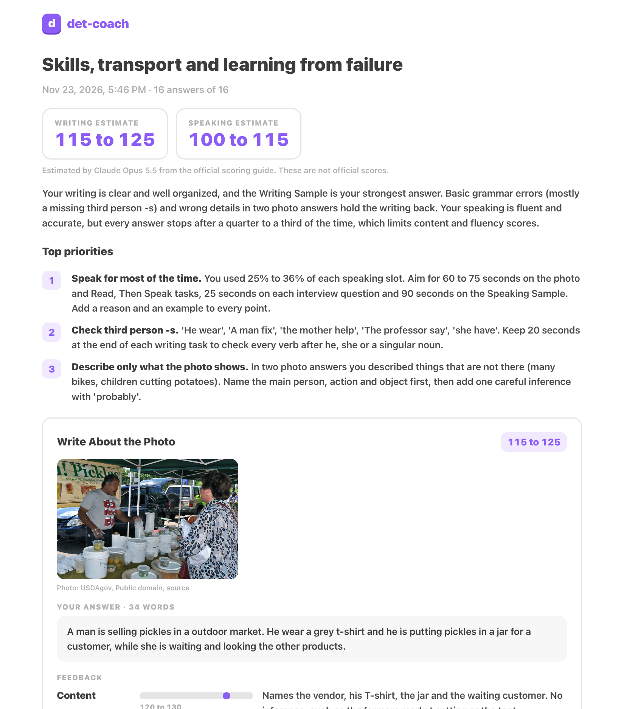

# det-coach

Practice the writing and speaking tasks of the Duolingo English Test with the official
timings, then get feedback on every answer from a coding agent such as Claude Code.

The official practice test gives you a score, but it does not tell you what to fix.
det-coach records your answers on your own computer. Your agent then grades each answer
against the official scoring criteria. It shows you score bands, your top priorities,
corrections of your own sentences and a stronger model answer.


## Features

- **All eight production tasks** in the order and with the times of the real test:
  Write About the Photo, Interactive Writing, Summarize the Conversation, Writing
  Sample, Speak About the Photo, Read, Then Speak, Interactive Speaking and Speaking
  Sample.
- **A test-like experience.** One timed screen at a time, no pause button, spell check
  off, and spoken questions that play once.
- **Local and private.** The app, the recordings and the transcription run on your
  computer.
- **Feedback in the app.** Score bands for each criterion, fixes that quote your own
  words, model answers, and your recordings with pauses marked in the transcript.
- **Open content.** Rounds are JSON files with original prompts and freely licensed
  photos. Your agent can write new rounds for you.

## Requirements

- Python 3.10 or newer and [uv](https://docs.astral.sh/uv/)
- Chrome, Safari or Firefox, with a microphone
- macOS for the best voices. On other systems the browser's own voice reads the
  questions.
- [ffmpeg](https://ffmpeg.org) on macOS, to join the voices of a conversation and to
  transcribe recordings with mlx-whisper

## Quick start

```bash
git clone https://github.com/adambarla/det-coach.git
cd det-coach
uv run det-coach practice
```

Your browser opens at http://127.0.0.1:8765. Choose a round and start. Your answers
save to `attempts/` as you go.

## Commands

| Command | What it does |
|---|---|
| `uv run det-coach practice` | Start the app and open it in the browser. Add `--round round-02` to go straight to a round, `--port` to change the port, `--no-open` to not open a browser. |
| `uv run det-coach attempts` | List your attempts and whether they have feedback. |
| `uv run det-coach transcribe [attempt]` | Transcribe the recordings of an attempt. `--force` transcribes again. |
| `uv run det-coach packet [attempt]` | Transcribe, then write `packet.md`: every prompt, answer, transcript and measure in one file for grading. |
| `uv run det-coach check-feedback [attempt]` | Validate the `feedback.json` of an attempt. |
| `uv run det-coach check` | Validate every round in `rounds/`. |
| `uv run det-coach fetch-photo <round> "File:<title>"` | Download a freely licensed photo from Wikimedia Commons into a round and print its attribution. |

`[attempt]` is an attempt id. Without it, the commands use the latest finished attempt.
Add `--help` to any command for all its options.

## Get feedback

Grading needs a coding agent and a local Whisper model for the recordings.

1. Install transcription once. The first run downloads a model of about 1.5 GB.

   ```bash
   uv sync --extra mlx       # Apple Silicon
   uv sync --extra whisper   # other systems
   ```

2. Open your coding agent in the `det-coach` folder and ask:

   > Grade my latest det-coach attempt.

   In Claude Code you can also type `/grade-attempt`. Other agents read
   [AGENTS.md](AGENTS.md).

3. The results page in the app shows the feedback as soon as the agent saves it.

The agent follows [docs/grading.md](docs/grading.md) and the
[rubric](rubric/rubric.md), which paraphrases the official
[Scoring Guide](https://englishtest-static.duolingo.com/media/resources/DET_Scoring%20Guide%20for%20Teachers%20%282026%29.pdf).
You can also grade by hand: run `det-coach packet` and read `packet.md`.



### What the feedback can and cannot do

- The score bands are estimates. The real test uses its own scoring models.
- Pronunciation is the weakest criterion. The agent reads a transcript and cannot
  hear you. It only uses indirect evidence, such as words that the transcription
  model heard with low confidence.
- Fluency uses measured evidence: words per minute, pauses and fillers.
- If your agent runs on a cloud model, the packet (your written answers and the
  transcripts) goes to that provider. Your recordings stay on your computer.

## Natural voices on macOS

The spoken questions use the macOS `say` command. Premium voices sound much more
natural. Download some in **System Settings › Accessibility › Spoken Content ›
System Voice › Manage Voices**, for example *Ava (Premium)*, *Zoe (Premium)*,
*Jamie (Premium)* and *Serena (Premium)*. Then restart `det-coach practice`.
The app selects the best voices that are installed.

## More rounds

Each folder in [`rounds/`](rounds) is a round. To make a new round, ask your agent:

> Make a new det-coach round about travel and health.

Or write one yourself with [docs/authoring-rounds.md](docs/authoring-rounds.md).

## Development

```bash
uv sync --group dev
uv run pytest
uv run ruff check .
uv run ruff format .
```

The app is plain HTML, CSS and JavaScript in `src/detcoach/static/`, with no build step.
The server uses only the Python standard library.
[AGENTS.md](AGENTS.md) describes the layout of the code.

## Credits and license

The code is under the [MIT License](LICENSE). The photos come from Wikimedia Commons
under their own free licenses. Each `round.json` lists the author, license and source
of its photos, and the results page shows them.

det-coach is an independent project. It is not affiliated with or endorsed by
Duolingo. "Duolingo English Test" is a trademark of Duolingo, Inc.
